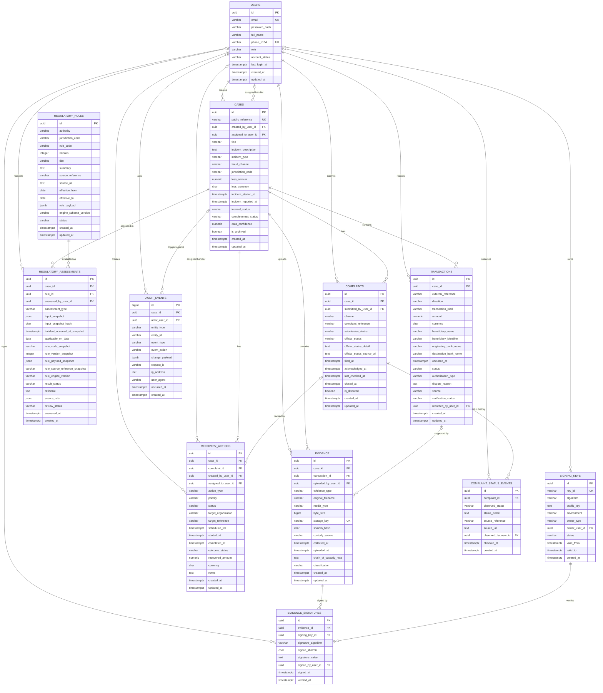

# Database design

**Status:** Revised design — awaiting review. No SQLAlchemy models or Alembic migrations exist yet.
**Scope of this document:** the complete logical schema for Phase 2. Physical DDL is produced later, from this document, as SQLAlchemy models and an Alembic initial migration.

PostgreSQL 16 is the primary database. SQLAlchemy 2.0 provides ORM mapping and Alembic provides migrations.

`NULL` in the tables below means the column is nullable.

---

## 1. Conventions

### 1.1 Established project conventions (unchanged)

- SQLAlchemy models derive from `app.database.base.Base`.
- Model definitions belong in `app/models`.
- Pydantic data transfer objects belong in `app/schemas`.
- Database sessions are created by `app/database/connection.py`.
- Schema changes should use Alembic migrations rather than direct production schema edits.

### 1.2 Naming and structure

- Table names are plural `snake_case` (`users`, `regulatory_assessments`).
- Column names are `snake_case`; foreign keys are `<entity>_id`; timestamps end in `_at`; dates end in `_on`; booleans start with `is_`.
- Constraint names are explicit and prefixed: `pk_`, `fk_`, `uq_`, `ck_`, `ix_`, `trg_`.
- Every foreign key gets an index on the referencing column. PostgreSQL does not create one automatically, and unindexed FKs make cascade checks and joins slow.

### 1.3 Primary keys

- All domain tables use `uuid` primary keys with `DEFAULT gen_random_uuid()` (built into PostgreSQL 13+; no extension required).
- Rationale: identifiers appear in URLs and complaint paperwork, so enumerable sequential IDs would leak case volume and invite access attempts. UUIDs also let the API and test fixtures construct records before insert.
- Exception: `audit_events` uses `bigint GENERATED ALWAYS AS IDENTITY` because audit rows need a cheap, strictly monotonic insertion order for review, and the identifier is never treated as a secret.

### 1.4 Time, money, and text

- All timestamps are `timestamptz`, `NOT NULL DEFAULT now()` unless stated. Naive timestamps are never used; incident times arrive from users in IST and are stored with offset.
- `created_at` and `updated_at` are `NOT NULL DEFAULT now()`; `updated_at` is maintained in the service layer (`onupdate`) — no database trigger, to keep behavior visible in Python code.
- Money is `numeric(18,2)` with an explicit `currency` column (`char(3)`, default `'INR'`). Floating point is never used for amounts.
- Free text has explicit length ceilings; descriptions use `text` with application-level limits (validated by Pydantic, not the database).

### 1.5 Enum strategy

Two different mechanisms, chosen deliberately:

- **Fixed, security-relevant vocabularies use `varchar` + `CHECK` constraints** — `role`, `account_status`, `direction`, `submission_status`, `event_action`, `status` fields. These change rarely and a migration is the correct control point.
- **Extensible domain vocabularies are `varchar` with no `CHECK`** — `cases.incident_type`, `cases.fraud_channel`, `evidence.evidence_type`, `complaints.channel`, `recovery_actions.action_type`. New fraud categories (investment scams, loan scams, future channels) must be introducible without a schema migration and without a `CHECK` rewrite, per the extensibility requirement. These values are validated against a code-level registry in the relevant module and documented in that module's README.
- PostgreSQL native `ENUM` types are intentionally **not** used: altering them requires `ALTER TYPE` migrations and they behave poorly with Alembic autogenerate.

### 1.6 Deletion and retention

- `users`, `cases`, `transactions`, `evidence`, `complaints`, `recovery_actions`, `regulatory_rules` are never hard-deleted by the application. They are archived, closed, or status-transitioned (`cases.is_archived`, `users.account_status`, `regulatory_rules.status`).
- `ON DELETE CASCADE` is used only where the child row has no independent meaning: `complaint_status_events` (history of one complaint) and `evidence_signatures` (signatures over one evidence blob).
- `audit_events`, `regulatory_assessments`, and `regulatory_rules` references use `ON DELETE RESTRICT` so that history cannot be removed as a side effect.

### 1.7 Cross-case integrity technique

The review requires that child rows can never point at a parent from a different case (evidence → transaction, recovery action → complaint). A plain foreign key on the child's surrogate id cannot express that.

Solution used throughout: every case-scoped parent exposes a **redundant unique key on `(id, case_id)`**, and children reference the **pair**:

```sql
ALTER TABLE transactions ADD CONSTRAINT uq_transactions_id_case UNIQUE (id, case_id);
ALTER TABLE evidence
  ADD CONSTRAINT fk_evidence_transaction_case
  FOREIGN KEY (transaction_id, case_id)
  REFERENCES transactions (id, case_id);
```

Because the foreign key uses `MATCH SIMPLE` (the PostgreSQL default), the constraint is not enforced when `transaction_id` is `NULL` — so evidence that is not attached to a transaction is still allowed. When `transaction_id` is set, the transaction must belong to the same `case_id` as the evidence. The `case_id` column is shared between the child's own `cases` foreign key and the composite key, so a database-level conflict is impossible.

`ON UPDATE CASCADE` is used on these composite keys because `case_id` is mutable in principle (case merge is a future feature); `ON DELETE RESTRICT` is used because deleting a referenced parent is not permitted.

---

## 2. Schema overview

Ten application tables plus two supporting tables required by the review:

| # | Table | Purpose |
|---|-------|---------|
| 1 | `users` | Accounts, roles, authentication state |
| 2 | `cases` | Registered fraud incidents |
| 3 | `transactions` | Reported financial movements with provenance |
| 4 | `evidence` | Evidence metadata, storage pointer, SHA-256 |
| 5 | `signing_keys` | Registry of Ed25519 public keys *(supporting)* |
| 6 | `evidence_signatures` | Signatures over evidence hashes *(supporting)* |
| 7 | `regulatory_rules` | Versioned, source-backed rule definitions |
| 8 | `regulatory_assessments` | Immutable evaluation records |
| 9 | `complaints` | Complaint submissions and last observed official status |
| 10 | `complaint_status_events` | Append-only official status history |
| 11 | `recovery_actions` | Recommended and tracked recovery steps |
| 12 | `audit_events` | Append-only audit trail |

### 2.1 ER diagram



### 2.2 Diagram corrections applied

The previously proposed diagram had these defects, now fixed:

1. **Removed the `USERS`–`TRANSACTIONS` relation drawn as a direct owner relationship.** Transactions belong to a case, not to a user; the only user link is `transactions.recorded_by_user_id` (recorded provenance), which is drawn as an optional *recording* relation.
2. **Correct nullable cardinalities.** `cases.assigned_to_user_id`, `recovery_actions.assigned_to_user_id`, `evidence.transaction_id`, `recovery_actions.complaint_id`, `audit_events.case_id`, `audit_events.actor_user_id`, `signing_keys.owner_user_id` and `evidence_signatures.signed_by_user_id` are all nullable and are drawn with `|o--o{` (zero-or-one) rather than `||--o{`.
3. **`complaints` → `complaint_status_events` is 1:N**, not a single status column on the complaint.
4. **`evidence` → `evidence_signatures` is 1:N**, and `signing_keys` → `evidence_signatures` is 1:N; signature metadata is no longer a set of columns on `evidence`.
5. **`regulatory_rules` → `regulatory_assessments` is 1:N across versions**; an assessment stores a snapshot of the rule it evaluated, so rule history stays readable even after a rule is superseded.
6. **`audit_events` is drawn as an optional leaf** attached to a case; it has no inbound relationships and is never a cascade target.
7. **Self-references are omitted from the diagram** (Mermaid renders self-relations inconsistently) and documented here instead: `regulatory_rules.superseded_by_rule_id → regulatory_rules.id` (nullable, `RESTRICT`) and `regulatory_assessments.supersedes_assessment_id → regulatory_assessments.id` (nullable, `RESTRICT`).
8. **Composite keys are not expressible in Mermaid.** `(id, case_id)` unique keys on `transactions` and `complaints`, and the composite foreign keys that consume them, are documented in §1.7 and in the per-table constraint lists.

---

## 3. Table specifications

### 3.1 `users`

| Column | Type | Null | Default | Constraints / notes |
|---|---|---|---|---|
| `id` | uuid | no | `gen_random_uuid()` | PK |
| `email` | varchar(320) | no | — | Unique on `lower(email)`; stored lowercased by the service |
| `password_hash` | varchar(255) | no | — | Argon2id hash only. Never plaintext, never reversible |
| `full_name` | varchar(200) | no | — | Personal data, classified `confidential` |
| `phone_e164` | varchar(16) | yes | — | `ck_users_phone_e164`: `~ '^\+[1-9][0-9]{7,14}$'`; unique when present |
| `role` | varchar(32) | no | `'citizen'` | `ck_users_role`: `citizen`, `investigator`, `administrator` |
| `account_status` | varchar(32) | no | `'active'` | `ck_users_account_status`: `active`, `locked`, `suspended`, `deactivated` |
| `failed_login_count` | smallint | no | `0` | `CHECK (failed_login_count >= 0)`; drives lockout |
| `last_login_at` | timestamptz | yes | — | |
| `created_at` | timestamptz | no | `now()` | |
| `updated_at` | timestamptz | no | `now()` | |

Indexes: `ix_users_email_lower` (unique, `lower(email)`), `uq_users_phone_e164` (unique, partial `WHERE phone_e164 IS NOT NULL`), `ix_users_role`, `ix_users_account_status`.

Security: this table has **no** columns for OTPs, UPI PINs, card numbers, CVVs, banking passwords, security answers, or recovery codes. No such value may be accepted by the API; the schema deliberately has nowhere to put one.

### 3.2 `cases`

| Column | Type | Null | Default | Constraints / notes |
|---|---|---|---|---|
| `id` | uuid | no | `gen_random_uuid()` | PK |
| `public_reference` | varchar(24) | no | — | Unique. Human-readable case reference (e.g. `FT-2026-7K3M9Q`), generated by the cases module, never derived from `id` |
| `created_by_user_id` | uuid | no | — | FK `users(id)` `RESTRICT` |
| `assigned_to_user_id` | uuid | yes | — | FK `users(id)` `RESTRICT`; nullable (unassigned is normal) |
| `title` | varchar(200) | no | — | |
| `incident_description` | text | no | — | User's own words. Application cap 20 000 chars |
| `incident_type` | varchar(64) | no | — | Code list (no `CHECK`, see §1.5): `upi_payment_fraud`, `otp_social_engineering`, `unauthorized_bank_transaction`, `card_fraud`, `phishing`, `fake_kyc_impersonation`, `other_digital_fraud` |
| `fraud_channel` | varchar(64) | yes | — | e.g. `upi_app`, `phone_call`, `sms`, `email`, `whatsapp`, `web_form`, `atm`, `pos` |
| `jurisdiction_code` | varchar(8) | no | `'IN'` | ISO 3166-1 alpha-2, optionally with subdivision (`IN-KA`) |
| `loss_amount` | numeric(18,2) | yes | — | `CHECK (loss_amount IS NULL OR loss_amount >= 0)`; nullable because the amount is often unknown at intake |
| `loss_currency` | char(3) | no | `'INR'` | `CHECK (loss_currency ~ '^[A-Z]{3}$')` |
| `incident_started_at` | timestamptz | yes | — | **The incident date used for regulatory rule applicability.** Nullable, but an assessment cannot be produced until it is known (§3.8) |
| `incident_reported_at` | timestamptz | yes | — | When the victim reported to bank/1930/portal |
| `internal_status` | varchar(32) | no | `'intake'` | `CHECK`: `intake`, `collecting_evidence`, `assessment`, `recovery`, `closed` |
| `completeness_status` | varchar(32) | no | `'incomplete'` | `CHECK`: `incomplete`, `partial`, `complete` |
| `data_confidence` | numeric(3,2) | yes | — | `CHECK (data_confidence BETWEEN 0 AND 1)`. **Input-data quality only** (how much of the incident is documented). Never a fraud probability and never an input to a regulatory result |
| `is_archived` | boolean | no | `false` | Archiving replaces deletion |
| `created_at` | timestamptz | no | `now()` | |
| `updated_at` | timestamptz | no | `now()` | |

Indexes: `uq_cases_public_reference` (unique), `ix_cases_created_by_user_id`, `ix_cases_assigned_to_user_id`, `ix_cases_internal_status`, `ix_cases_incident_type`, `ix_cases_created_at` (`DESC`), `ix_cases_active` (partial `WHERE NOT is_archived`).

No cross-column date ordering constraint (`incident_started_at <= incident_reported_at`) is enforced: the product must accept incomplete and disputed input, and an impossible order is a *completeness* signal surfaced to the user, not a write error.

### 3.3 `transactions`

| Column | Type | Null | Default | Constraints / notes |
|---|---|---|---|---|
| `id` | uuid | no | `gen_random_uuid()` | PK |
| `case_id` | uuid | no | — | FK `cases(id)` `RESTRICT` |
| `external_reference` | varchar(128) | yes | — | UTR / RRN / bank reference as reported. Never a card PAN |
| `direction` | varchar(16) | no | — | `CHECK`: `debit`, `credit` |
| `transaction_kind` | varchar(32) | no | — | `CHECK`: `upi`, `card`, `netbanking`, `atm`, `wallet`, `other` |
| `amount` | numeric(18,2) | no | — | `CHECK (amount > 0)` |
| `currency` | char(3) | no | `'INR'` | `CHECK (currency ~ '^[A-Z]{3}$')` |
| `beneficiary_name` | varchar(200) | yes | — | As reported by the victim; unverified |
| `beneficiary_identifier` | varchar(256) | yes | — | UPI VPA / masked account / masked card. **Partial PAN/CVV/full account numbers are rejected at the API layer**; returned masked |
| `originating_bank_name` | varchar(128) | yes | — | |
| `destination_bank_name` | varchar(128) | yes | — | |
| `occurred_at` | timestamptz | no | — | Required: a transaction with no time cannot be assessed. Enforced at API validation, not by `DEFAULT now()` |
| `status` | varchar(32) | no | `'reported'` | `CHECK`: `reported`, `disputed`, `reversed`, `chargeback`, `unresolved` |
| `authorization_type` | varchar(32) | no | `'unknown'` | `CHECK`: `unauthorized`, `authorized_deceived`, `unknown`. **Implements the product's core distinction** between an unauthorized transaction and a deception-induced authorized payment. Must be citizen-confirmable, never inferred silently |
| `dispute_reason` | text | yes | — | |
| `source` | varchar(32) | no | `'user_declared'` | `CHECK`: `user_declared`, `extracted`, `imported`. **Provenance**: how the row came to exist |
| `verification_status` | varchar(32) | no | `'unverified'` | `CHECK`: `unverified`, `user_confirmed`, `disputed`. Distinguishes machine-extracted from user-confirmed data |
| `recorded_by_user_id` | uuid | yes | — | FK `users(id)` `SET NULL`; `NULL` for system extraction |
| `created_at` | timestamptz | no | `now()` | |
| `updated_at` | timestamptz | no | `now()` | |

Constraints:
- `uq_transactions_id_case` **unique `(id, case_id)`** — target of the evidence composite FK (§1.7).
- `uq_transactions_case_external_ref` unique `(case_id, external_reference)` partial `WHERE external_reference IS NOT NULL` — the same UTR must not appear twice in one case, but unknown references stay allowed.

Indexes: `ix_transactions_case_id`, `ix_transactions_occurred_at`, `ix_transactions_verification_status`, `ix_transactions_source`.

Provenance is deliberately split into three fields (`source`, `verification_status`, `recorded_by_user_id`) rather than one flag, because "extracted by the system", "confirmed by the victim", and "disputed later" are independent facts. Extracted rows are traceable to the evidence that produced them through `evidence.transaction_id` (see §3.4), so no circular key is needed. Transaction data is user- or evidence-derived and is never presented as bank-verified.

### 3.4 `evidence`

| Column | Type | Null | Default | Constraints / notes |
|---|---|---|---|---|
| `id` | uuid | no | `gen_random_uuid()` | PK |
| `case_id` | uuid | no | — | FK `cases(id)` `RESTRICT` |
| `transaction_id` | uuid | yes | — | **Composite FK `(transaction_id, case_id) → transactions(id, case_id)`** `RESTRICT` (§1.7). Nullable: evidence need not relate to a transaction |
| `uploaded_by_user_id` | uuid | no | — | FK `users(id)` `RESTRICT` |
| `evidence_type` | varchar(32) | no | — | `screenshot`, `receipt`, `bank_statement`, `sms`, `email`, `call_log`, `audio`, `video`, `pdf`, `other` (no `CHECK`, §1.5) |
| `original_filename` | varchar(255) | no | — | Preserved as supplied; **never used as a path component** |
| `media_type` | varchar(127) | no | — | Sniffed server-side, not trusted from the client |
| `byte_size` | bigint | no | — | `CHECK (byte_size > 0)` |
| `storage_key` | varchar(512) | no | — | Opaque key in private evidence storage. Unique. Never a public URL, never contains the original filename or the case reference |
| `sha256_hash` | char(64) | no | — | `CHECK (sha256_hash ~ '^[0-9a-f]{64}$')`. **Not unique** (§3.4.1) |
| `custody_source` | varchar(32) | no | — | `CHECK`: `victim_device`, `bank_portal`, `email`, `sms`, `third_party`, `other` |
| `collected_at` | timestamptz | yes | — | When the artifact was obtained, as claimed by the uploader. Claimed, not verified |
| `uploaded_at` | timestamptz | no | `now()` | Server-observed |
| `chain_of_custody_note` | text | yes | — | Free-text custody context |
| `provenance_note` | text | yes | — | Who supplied it and how |
| `classification` | varchar(32) | no | `'confidential'` | `CHECK`: `confidential`, `restricted`, `internal` |
| `retention_until` | date | yes | — | Planned deletion/review date; see unresolved decision U5 |
| `created_at` | timestamptz | no | `now()` | |
| `updated_at` | timestamptz | no | `now()` | |

Constraints: `uq_evidence_storage_key` unique; `uq_evidence_id_case` unique `(id, case_id)` (reserved for future case-scoped composite references).

Indexes: `ix_evidence_case_id`, `ix_evidence_transaction_id`, `ix_evidence_uploaded_by_user_id`, `ix_evidence_sha256_hash`, `ix_evidence_case_created_at`.

#### 3.4.1 Duplicate hashes are allowed

`sha256_hash` is **not** unique. The same file legitimately reaches the platform more than once: two victims uploading the same scam message, a screenshot submitted in two cases, a re-upload after a client retry, or the same statement supplied by the victim and by a bank. Uniqueness would either block those uploads or silently merge distinct provenance records — destroying exactly the chain-of-custody information the table exists to keep. Lookup by hash is served by `ix_evidence_sha256_hash`, and a match is reported as an observation ("this content already exists in case X"), never as a merge.

#### 3.4.2 Signature columns removed from `evidence`

`signature_algorithm`, `signature_value` and `signature_key_id` are gone from this table. Storing one signature inline permitted exactly one signature per artifact, could not record which bytes were signed, and left key identity as a bare string with no registry. Signatures now live in `evidence_signatures` with a key registry in `signing_keys` (§3.5, §3.6).

### 3.5 `signing_keys` (supporting)

| Column | Type | Null | Default | Constraints / notes |
|---|---|---|---|---|
| `id` | uuid | no | `gen_random_uuid()` | PK |
| `key_id` | varchar(64) | no | — | Unique public key identifier (`kid`) referenced by signatures |
| `algorithm` | varchar(32) | no | `'Ed25519'` | `CHECK (algorithm = 'Ed25519')` for the first release |
| `public_key` | text | no | — | Base64url raw 32-byte Ed25519 public key. **Only public material is stored** |
| `key_purpose` | varchar(32) | no | `'evidence_signature'` | `CHECK`: `evidence_signature`, `assessment_attestation` |
| `environment` | varchar(16) | no | — | `CHECK`: `development`, `test`, `production`; stops a dev key verifying production evidence |
| `owner_type` | varchar(32) | no | `'platform'` | `CHECK`: `platform`, `user` |
| `owner_user_id` | uuid | yes | — | FK `users(id)` `SET NULL`; `ck_signing_keys_owner`: `(owner_type = 'platform' AND owner_user_id IS NULL) OR (owner_type = 'user' AND owner_user_id IS NOT NULL)` |
| `status` | varchar(16) | no | `'active'` | `CHECK`: `active`, `retired`, `revoked` |
| `valid_from` | timestamptz | no | `now()` | |
| `valid_to` | timestamptz | yes | — | `CHECK (valid_to IS NULL OR valid_to > valid_from)` |
| `created_at` | timestamptz | no | `now()` | |
| `updated_at` | timestamptz | no | `now()` | |

Indexes: `uq_signing_keys_key_id` (unique), `ix_signing_keys_status`.

Key management rules:
- **Private keys are never stored in the database, in the repository, or in logs.** They live in the deployment secret store (environment variable or secret file, path in configuration) and are loaded by the evidence module.
- The registry is append-and-retire: a compromised key is `revoked`, never deleted, so previously accepted signatures stay explainable.
- Verification requires `status = 'active'` (or `retired` with verification inside `[valid_from, valid_to]`), matching `environment`, and `owner` resolution consistent with `owner_type`.

### 3.6 `evidence_signatures` (supporting, append-only)

| Column | Type | Null | Default | Constraints / notes |
|---|---|---|---|---|
| `id` | uuid | no | `gen_random_uuid()` | PK |
| `evidence_id` | uuid | no | — | FK `evidence(id)` `ON DELETE CASCADE` |
| `signing_key_id` | uuid | no | — | FK `signing_keys(id)` `RESTRICT` |
| `signature_algorithm` | varchar(32) | no | — | `CHECK`: `Ed25519`. Snapshot of what was used, not read from the key row |
| `signed_sha256` | char(64) | no | — | The hash that was actually signed. Immutable snapshot: if `evidence.sha256_hash` ever changes, the mismatch proves tampering |
| `signature_value` | text | no | — | Base64url signature bytes |
| `signature_scope` | varchar(32) | no | `'content_sha256'` | `CHECK`: `content_sha256`, `manifest` |
| `signed_by_user_id` | uuid | yes | — | FK `users(id)` `SET NULL`; `NULL` for system signing |
| `signed_at` | timestamptz | no | `now()` | Server clock at signing. **Not** a trusted external timestamp |
| `verified_at` | timestamptz | yes | — | Last successful verification |
| `verification_note` | varchar(300) | yes | — | |
| `created_at` | timestamptz | no | `now()` | |

Constraints: `uq_evidence_signatures_evidence_key_hash` unique `(evidence_id, signing_key_id, signed_sha256)` — repeated identical re-signing is idempotent; a second signer adds a row.

Indexes: `ix_evidence_signatures_evidence_id`, `ix_evidence_signatures_signing_key_id`.

Append-only: the application role holds `INSERT`/`SELECT` only. Neither a signature nor a verification timestamp may be rewritten to claim success.

**What a signature does and does not mean** (documented in the module README and surfaced in API responses): it demonstrates that the holder of the corresponding private key signed these bytes. It does not prove the evidence is genuine, that it existed at `signed_at` in any externally attested sense, or who originally created it. `evidence.sha256_hash` proves the stored bytes match a recorded value — not that the content is authentic.

### 3.7 `regulatory_rules`

| Column | Type | Null | Default | Constraints / notes |
|---|---|---|---|---|
| `id` | uuid | no | `gen_random_uuid()` | PK |
| `authority` | varchar(64) | no | — | Issuing authority, e.g. `RBI`, `NPCI` |
| `jurisdiction_code` | varchar(8) | no | `'IN'` | |
| `rule_code` | varchar(64) | no | — | Stable code shared across versions, e.g. `RBI_ULB_ZERO_LIABILITY` |
| `version` | integer | no | — | `CHECK (version >= 1)`; increments per rule_code |
| `title` | varchar(300) | no | — | |
| `summary` | text | no | — | Plain-language summary for display |
| `source_reference` | varchar(300) | no | — | Exact citation: circular number, date, paragraph |
| `source_url` | text | yes | — | Official source where available |
| `effective_from` | date | no | — | |
| `effective_to` | date | yes | — | `CHECK (effective_to IS NULL OR effective_to >= effective_from)` |
| `rule_payload` | jsonb | no | — | Deterministic predicate tree evaluated by the engine. No natural-language instructions, no model prompts |
| `engine_schema_version` | varchar(16) | no | — | Schema version of `rule_payload` |
| `status` | varchar(16) | no | `'draft'` | `CHECK`: `draft`, `active`, `deprecated`, `superseded` |
| `superseded_by_rule_id` | uuid | yes | — | Self FK `RESTRICT` |
| `created_at` | timestamptz | no | `now()` | |
| `updated_at` | timestamptz | no | `now()` | |

Constraints: `uq_regulatory_rules_identity` unique `(authority, jurisdiction_code, rule_code, version)`.

Indexes: `ix_regulatory_rules_authority_rule_code`, `ix_regulatory_rules_status_effective_from`.

Rules are **immutable once `status = 'active'`**. A trigger (§4) rejects `UPDATE` to `rule_payload`, `effective_from`, `effective_to`, `source_reference`, `source_url`, `engine_schema_version`, `rule_code` or `version`; only `status` and `superseded_by_rule_id` may change. Correction means a new `version` row, which is what makes historical assessments explainable. Rules are seeded by migration/script, not by a user-facing API; no endpoint writes to this table in the prototype.

### 3.8 `regulatory_assessments` (immutable result snapshot)

| Column | Type | Null | Default | Constraints / notes |
|---|---|---|---|---|
| `id` | uuid | no | `gen_random_uuid()` | PK |
| `case_id` | uuid | no | — | FK `cases(id)` `RESTRICT` |
| `rule_id` | uuid | no | — | FK `regulatory_rules(id)` `RESTRICT` |
| `assessed_by_user_id` | uuid | no | — | FK `users(id)` `RESTRICT`; the user who triggered the run (a system re-run is still attributed to a triggering user) |
| `assessment_type` | varchar(32) | no | — | `CHECK`: `rule_applicability`, `liability_band`, `obligation_check` |
| `input_snapshot` | jsonb | no | — | **Exact facts used**, as a versioned document (`{"snapshot_schema": 1, ...}`) |
| `input_snapshot_hash` | char(64) | no | — | SHA-256 of the canonicalised snapshot; makes re-runs idempotent and tampering detectable |
| `incident_occurred_at_snapshot` | timestamptz | yes | — | The incident date copied from the case at assessment time. `NULL` means the rule could not be date-gated and the result must be `inconclusive` |
| `applicable_on_date` | date | no | — | The date the engine used to check rule effective windows |
| `rule_code_snapshot` | varchar(64) | no | — | Rule identity at assessment time |
| `rule_version_snapshot` | integer | no | — | Exact rule version evaluated |
| `rule_title_snapshot` | varchar(300) | no | — | |
| `rule_payload_snapshot` | jsonb | no | — | |
| `rule_source_reference_snapshot` | varchar(300) | no | — | |
| `rule_source_url_snapshot` | text | yes | — | |
| `engine_schema_version` | varchar(16) | no | — | Schema version of the snapshot payload read |
| `rule_engine_version` | varchar(16) | no | — | Version of the deterministic evaluator |
| `result_status` | varchar(24) | no | — | `CHECK`: `applies`, `may_apply`, `does_not_apply`, `inconclusive`, `disputed` |
| `rationale` | text | no | — | Generated from the rule's own explanation template and the matched clause identifiers — deterministic text, not free-form model output |
| `source_refs` | jsonb | no | `'[]'` | Citations supporting each matched clause |
| `review_status` | varchar(16) | no | `'unreviewed'` | `CHECK`: `unreviewed`, `confirmed`, `rejected`, `disputed` |
| `reviewed_by_user_id` | uuid | yes | — | FK `users(id)` `SET NULL` |
| `reviewed_at` | timestamptz | yes | — | |
| `supersedes_assessment_id` | uuid | yes | — | Self FK `RESTRICT`; chains re-evaluations instead of overwriting |
| `assessed_at` | timestamptz | no | `now()` | |
| `created_at` | timestamptz | no | `now()` | |

There is **no `updated_at`**: the record is immutable apart from the human review fields.

Constraints: `uq_regulatory_assessments_idempotent` unique `(case_id, rule_id, rule_version_snapshot, rule_engine_version, input_snapshot_hash)` — the same facts evaluated by the same rule and engine version yield one row, so a retried request cannot duplicate assessments.

Indexes: `ix_regulatory_assessments_case_assessed_at` (`case_id`, `assessed_at DESC`), `ix_regulatory_assessments_rule_id`, `ix_regulatory_assessments_result_status`, `ix_regulatory_assessments_supersedes`.

Immutability rules (§4):
- All result-bearing columns are write-once: `UPDATE` to any column other than `review_status`, `reviewed_by_user_id`, `reviewed_at` raises an exception.
- `DELETE` is rejected.
- A changed input, rule version, or engine version produces a **new** assessment row that references the earlier one via `supersedes_assessment_id`. Nothing is recomputed in place, so an old report always reproduces what was decided, and why.

**`confidence` is removed** from this table. A numeric score attached to a regulatory outcome invites it to be read as a liability probability, which the platform must not assert. The honest vocabulary is already present: `result_status` (`applies` / `may_apply` / `does_not_apply` / `inconclusive` / `disputed`) and `review_status`. Case-level input quality remains available as `cases.data_confidence`, which is never used to produce a result.

### 3.9 `complaints`

| Column | Type | Null | Default | Constraints / notes |
|---|---|---|---|---|
| `id` | uuid | no | `gen_random_uuid()` | PK |
| `case_id` | uuid | no | — | FK `cases(id)` `RESTRICT` |
| `submitted_by_user_id` | uuid | no | — | FK `users(id)` `RESTRICT` |
| `channel` | varchar(32) | no | — | `bank`, `cybercrime_portal`, `helpline_1930`, `police`, `rbi_ombudsman`, `other` (no `CHECK`, §1.5) |
| `complaint_reference` | varchar(128) | yes | — | Issued by the receiving organisation. `NULL` until filed — FINTRACE never invents a reference |
| `submission_status` | varchar(24) | no | `'draft'` | `CHECK`: `draft`, `ready`, `submitted`, `acknowledged`, `rejected`, `withdrawn` |
| `official_status` | varchar(48) | yes | — | **Nullable by design.** Unknown until the victim reports it; absence of a value is information, and a default would be a fabricated status |
| `official_status_detail` | text | yes | — | |
| `official_status_source_url` | text | yes | — | |
| `filed_at` | timestamptz | yes | — | |
| `acknowledged_at` | timestamptz | yes | — | |
| `last_checked_at` | timestamptz | yes | — | Last time the victim/reviewer checked the official status |
| `closed_at` | timestamptz | yes | — | |
| `is_disputed` | boolean | no | `false` | Marks a victim–organisation disagreement about status |
| `created_at` | timestamptz | no | `now()` | |
| `updated_at` | timestamptz | no | `now()` | |

Constraints:
- `uq_complaints_id_case` **unique `(id, case_id)`** — target of the recovery-action composite FK.
- `uq_complaints_case_channel_reference` unique `(case_id, channel, complaint_reference)` partial `WHERE complaint_reference IS NOT NULL`.
- `ck_complaints_filed_at`: `submission_status NOT IN ('submitted','acknowledged') OR filed_at IS NOT NULL`.
- `ck_complaints_acknowledged_at`: `submission_status <> 'acknowledged' OR acknowledged_at IS NOT NULL`.
- `ck_complaints_closed_at`: `closed_at IS NULL OR filed_at IS NOT NULL` — only a filed complaint can be closed.

Indexes: `ix_complaints_case_id`, `ix_complaints_case_channel`, `ix_complaints_submission_status`, `ix_complaints_official_status`.

`official_status`, `official_status_detail`, `official_status_source_url`, `last_checked_at` are a **cache of the newest `complaint_status_events` row**, written in the same transaction as that row. `complaint_status_events` is authoritative; the cache exists so lists render without a correlated subquery. If they ever disagree, history wins and the service repairs the cache.

Complaints are recorded, not transmitted. FINTRACE has **no** integration that files a complaint with any organisation; `submission_status` records what the user reports doing themselves.

### 3.10 `complaint_status_events` (append-only history)

| Column | Type | Null | Default | Constraints / notes |
|---|---|---|---|---|
| `id` | uuid | no | `gen_random_uuid()` | PK |
| `complaint_id` | uuid | no | — | FK `complaints(id)` `ON DELETE CASCADE` |
| `observed_status` | varchar(48) | no | — | **`NOT NULL`**: an observation always has a status; "unknown" is recorded as not-yet-observed, i.e. no row |
| `status_detail` | text | yes | — | |
| `source_reference` | varchar(200) | yes | — | e.g. portal acknowledgement number |
| `source_url` | text | yes | — | |
| `observed_by_user_id` | uuid | yes | — | FK `users(id)` `SET NULL` |
| `checked_at` | timestamptz | no | — | When the status was checked (caller-supplied); distinct from `created_at` |
| `created_at` | timestamptz | no | `now()` | |

Constraints: `uq_complaint_status_events_observation` unique `(complaint_id, checked_at, observed_status)` — an identical repeat observation is a no-op rather than a duplicate.

Indexes: `ix_complaint_status_events_complaint_checked` (`complaint_id`, `checked_at DESC`).

Append-only: `INSERT`/`SELECT` only for the application role. Correction is a new observation, never a rewrite.

### 3.11 `recovery_actions`

| Column | Type | Null | Default | Constraints / notes |
|---|---|---|---|---|
| `id` | uuid | no | `gen_random_uuid()` | PK |
| `case_id` | uuid | no | — | FK `cases(id)` `RESTRICT` |
| `complaint_id` | uuid | yes | — | **Composite FK `(complaint_id, case_id) → complaints(id, case_id)`** `RESTRICT` (§1.7). Nullable: many actions precede any complaint |
| `created_by_user_id` | uuid | no | — | FK `users(id)` `RESTRICT` |
| `assigned_to_user_id` | uuid | yes | — | FK `users(id)` `RESTRICT`; nullable |
| `action_type` | varchar(48) | no | — | `contact_bank`, `freeze_account`, `report_1930`, `file_cybercrime_complaint`, `file_bank_chargeback`, `submit_documents`, `follow_up`, `police_complaint`, `rbi_ombudsman_escalation`, `other` (no `CHECK`, §1.5) |
| `priority` | varchar(16) | no | `'medium'` | `CHECK`: `urgent`, `high`, `medium`, `low` |
| `status` | varchar(24) | no | `'pending'` | `CHECK`: `pending`, `in_progress`, `blocked`, `completed`, `cancelled` |
| `target_organization` | varchar(200) | yes | — | |
| `target_reference` | varchar(128) | yes | — | Ticket/reference at that organisation |
| `scheduled_for` | timestamptz | yes | — | |
| `started_at` | timestamptz | yes | — | |
| `completed_at` | timestamptz | yes | — | |
| `outcome_status` | varchar(24) | yes | — | `CHECK`: `pending_response`, `recovered`, `partially_recovered`, `no_recovery`, `rejected`, `no_response`, `not_applicable`. Nullable until known |
| `recovered_amount` | numeric(18,2) | yes | — | `CHECK (recovered_amount IS NULL OR recovered_amount >= 0)` |
| `currency` | char(3) | no | `'INR'` | `CHECK (currency ~ '^[A-Z]{3}$')` |
| `notes` | text | yes | — | |
| `is_recommended_by_system` | boolean | no | `false` | Distinguishes generated suggestions from user-created steps |
| `created_at` | timestamptz | no | `now()` | |
| `updated_at` | timestamptz | no | `now()` | |

Constraints:
- `ck_recovery_actions_completed_at`: `status <> 'completed' OR completed_at IS NOT NULL`.
- `ck_recovery_actions_recovered_amount`: `recovered_amount IS NULL OR outcome_status IS NOT NULL`.
- `ck_recovery_actions_outcome_requires_completion`: `outcome_status IS NULL OR status IN ('completed','cancelled')` — an outcome belongs to a finished action.

Indexes: `ix_recovery_actions_case_id`, `ix_recovery_actions_case_status` (`case_id`, `status`), `ix_recovery_actions_complaint_id`, `ix_recovery_actions_assigned_to_user_id`, `ix_recovery_actions_scheduled_for`.

`recovered_amount` records what the victim reports recovering from a step. Nothing in the system asserts that a recovery will occur; there is no aggregate "expected recovery" field anywhere.

### 3.12 `audit_events` (append-only)

| Column | Type | Null | Default | Constraints / notes |
|---|---|---|---|---|
| `id` | bigint | no | identity | PK, `GENERATED ALWAYS AS IDENTITY` |
| `case_id` | uuid | yes | — | FK `cases(id)` `RESTRICT`. Nullable for account-level events not tied to a case |
| `actor_user_id` | uuid | yes | — | FK `users(id)` `RESTRICT`; `NULL` only for system events |
| `actor_role` | varchar(32) | yes | — | Role snapshot at event time |
| `entity_type` | varchar(48) | no | — | `user`, `case`, `transaction`, `evidence`, `evidence_signature`, `regulatory_rule`, `regulatory_assessment`, `complaint`, `complaint_status_event`, `recovery_action` |
| `entity_id` | varchar(64) | no | — | Text form of the affected id (allows future non-UUID keys) |
| `event_type` | varchar(64) | no | — | Dotted code, e.g. `case.created`, `evidence.uploaded`, `assessment.executed`, `complaint.status_observed`, `auth.login_failed` |
| `event_action` | varchar(32) | no | — | `CHECK`: `create`, `update`, `delete`, `read`, `verify`, `execute`, `login`, `logout`, `status_change` |
| `change_payload` | jsonb | yes | — | Redacted before/after diff. **Never** contains passwords, hashes of passwords, tokens, PINs, OTPs, full account numbers, or evidence bytes |
| `request_id` | varchar(64) | yes | — | Correlates with the API request |
| `ip_address` | inet | yes | — | Personal data; retention rules apply |
| `user_agent` | varchar(512) | yes | — | Truncated |
| `occurred_at` | timestamptz | no | `now()` | |
| `created_at` | timestamptz | no | `now()` | |

Indexes: `ix_audit_events_case_occurred` (`case_id`, `occurred_at DESC`), `ix_audit_events_entity` (`entity_type`, `entity_id`), `ix_audit_events_actor_occurred` (`actor_user_id`, `occurred_at DESC`), `ix_audit_events_event_type_occurred` (`event_type`, `occurred_at DESC`), `ix_audit_events_occurred_at` (`occurred_at DESC`).

No table has a foreign key **to** `audit_events`. Reading is restricted to the case owner (`citizen`), assigned handlers (`investigator`), and `administrator`.

---

## 4. Immutability and protection mechanisms

These are database-enforced, not conventions. They are implemented in the initial Alembic migration so no later code path can bypass them.

### 4.1 Append-only tables

`audit_events`, `evidence_signatures`, `complaint_status_events`:

```sql
CREATE OR REPLACE FUNCTION fintrace_reject_mutation() RETURNS trigger
LANGUAGE plpgsql AS $$
BEGIN
    RAISE EXCEPTION 'append-only table % rejects %', TG_TABLE_NAME, TG_OP;
END;
$$;

CREATE TRIGGER trg_audit_events_append_only
    BEFORE UPDATE OR DELETE ON audit_events
    FOR EACH ROW EXECUTE FUNCTION fintrace_reject_mutation();
-- same trigger on evidence_signatures and complaint_status_events
```

Plus privilege separation: the runtime role (`fintrace_app`) receives `SELECT, INSERT` on these tables and **no** `UPDATE`, `DELETE`, or `TRUNCATE`. The migration role (`fintrace_migrator`) owns the schema. `TRUNCATE` is additionally protected because triggers do not fire on it — only the privilege model covers that case.

### 4.2 Regulatory assessment immutability

```sql
CREATE OR REPLACE FUNCTION fintrace_assessment_guard() RETURNS trigger
LANGUAGE plpgsql AS $$
BEGIN
    NEW.case_id                       := OLD.case_id;
    NEW.rule_id                       := OLD.rule_id;
    NEW.assessed_by_user_id           := OLD.assessed_by_user_id;
    NEW.assessment_type               := OLD.assessment_type;
    NEW.input_snapshot                := OLD.input_snapshot;
    NEW.input_snapshot_hash           := OLD.input_snapshot_hash;
    NEW.incident_occurred_at_snapshot := OLD.incident_occurred_at_snapshot;
    NEW.applicable_on_date            := OLD.applicable_on_date;
    NEW.rule_code_snapshot            := OLD.rule_code_snapshot;
    NEW.rule_version_snapshot         := OLD.rule_version_snapshot;
    NEW.rule_title_snapshot           := OLD.rule_title_snapshot;
    NEW.rule_payload_snapshot         := OLD.rule_payload_snapshot;
    NEW.rule_source_reference_snapshot:= OLD.rule_source_reference_snapshot;
    NEW.rule_source_url_snapshot      := OLD.rule_source_url_snapshot;
    NEW.engine_schema_version         := OLD.engine_schema_version;
    NEW.rule_engine_version           := OLD.rule_engine_version;
    NEW.result_status                 := OLD.result_status;
    NEW.rationale                     := OLD.rationale;
    NEW.source_refs                   := OLD.source_refs;
    NEW.assessed_at                   := OLD.assessed_at;
    NEW.supersedes_assessment_id      := OLD.supersedes_assessment_id;
    NEW.created_at                    := OLD.created_at;
    RETURN NEW;
END;
$$;
```

Only `review_status`, `reviewed_by_user_id`, `reviewed_at` remain mutable. `DELETE` is blocked by a second trigger. A review trail of its own (who confirmed what, when) is written to `audit_events`.

### 4.3 Regulatory rule version immutability

`UPDATE` on `regulatory_rules` restores `rule_code`, `version`, `rule_payload`, `engine_schema_version`, `effective_from`, `effective_to`, `source_reference`, `source_url`, `authority` and `jurisdiction_code` from `OLD` once `OLD.status IN ('active','deprecated','superseded')`. `DELETE` is rejected for any row referenced by an assessment (the `RESTRICT` FK already enforces this).

### 4.4 Cross-case relationships

- `evidence (transaction_id, case_id) → transactions (id, case_id)`
- `recovery_actions (complaint_id, case_id) → complaints (id, case_id)`

Both are ordinary foreign keys, so no trigger is required, and they are validated by the database even for migrations, scripts, and future services.

---

## 5. Index and constraint summary

| Table | Unique | Notable non-unique indexes |
|---|---|---|
| `users` | `lower(email)`, `phone_e164` (partial) | `role`, `account_status` |
| `cases` | `public_reference` | `created_by_user_id`, `assigned_to_user_id`, `internal_status`, `incident_type`, `created_at DESC`, active partial |
| `transactions` | `(id, case_id)`, `(case_id, external_reference)` partial | `case_id`, `occurred_at`, `verification_status`, `source` |
| `evidence` | `storage_key`, `(id, case_id)` | `case_id`, `transaction_id`, `sha256_hash`, `uploaded_by_user_id`, `(case_id, created_at)` |
| `signing_keys` | `key_id` | `status` |
| `evidence_signatures` | `(evidence_id, signing_key_id, signed_sha256)` | `evidence_id`, `signing_key_id` |
| `regulatory_rules` | `(authority, jurisdiction_code, rule_code, version)` | `(authority, rule_code)`, `(status, effective_from)` |
| `regulatory_assessments` | `(case_id, rule_id, rule_version_snapshot, rule_engine_version, input_snapshot_hash)` | `(case_id, assessed_at DESC)`, `rule_id`, `result_status`, `supersedes_assessment_id` |
| `complaints` | `(id, case_id)`, `(case_id, channel, complaint_reference)` partial | `case_id`, `(case_id, channel)`, `submission_status`, `official_status` |
| `complaint_status_events` | `(complaint_id, checked_at, observed_status)` | `(complaint_id, checked_at DESC)` |
| `recovery_actions` | — | `case_id`, `(case_id, status)`, `complaint_id`, `assigned_to_user_id`, `scheduled_for` |
| `audit_events` | — (identity PK) | `(case_id, occurred_at DESC)`, `(entity_type, entity_id)`, `(actor_user_id, occurred_at DESC)`, `(event_type, occurred_at DESC)`, `occurred_at DESC` |

### 5.1 Nullability decisions worth calling out

| Column | Null? | Why |
|---|---|---|
| `cases.loss_amount` | yes | Amount is frequently unknown at intake; `NULL` is honest, `0` is not |
| `cases.incident_started_at` | yes | Often approximate or unknown; assessments must degrade to `inconclusive` rather than invent a date |
| `complaints.official_status` | yes | Unknown until observed; a default status would fabricate an official fact |
| `complaint_status_events.observed_status` | **no** | An observation always carries a status |
| `evidence.transaction_id` | yes | Evidence may document the incident without a specific transaction |
| `recovery_actions.complaint_id` | yes | Immediate steps (bank freeze, 1930) precede any complaint |
| `cases.assigned_to_user_id`, `recovery_actions.assigned_to_user_id` | yes | Most citizen cases have no handler |
| `regulatory_assessments.incident_occurred_at_snapshot` | yes | Preserves "unknown at assessment time" instead of backfilling a guess |
| `audit_events.actor_user_id` | yes | System events have no user actor |

---

## 6. Security and data-protection notes

1. **No authentication secrets in the schema.** There is no column for OTP, UPI PIN, ATM PIN, CVV, card number, banking password, security answer, or recovery code anywhere in these twelve tables. The API must reject requests containing them rather than dropping them silently.
2. **No full financial identifiers.** `transactions.beneficiary_identifier` is bounded and masked in API responses; `evidence.storage_key` is an opaque key, not a URL.
3. **Evidence stays private.** Files live outside the web root with no public URL; access is granted per request after authorization, and `storage_key` never leaks the case reference or filename.
4. **Audit is not user-writable.** See §4.1; admin UI actions use the same append-only path.
5. **Least privilege.** Two roles: `fintrace_migrator` (DDL, migrations) and `fintrace_app` (DML, no DDL, no `TRUNCATE`, no `UPDATE`/`DELETE` on append-only tables).
6. **Data branching is refused.** Application logs must not contain `change_payload` contents or evidence bytes; only identifiers and event codes.
7. **Regulatory authority stays auditable.** Rules, their exact versions, their sources, and every evaluation input are retained, so any conclusion can be re-derived or challenged.

---

## 7. Review-decision traceability

| Review item | Resolution |
|---|---|
| 1. Evidence ↔ transaction same-case | Composite FK `(transaction_id, case_id)` + unique `(id, case_id)` on `transactions` (§1.7, §3.4) |
| 2. Recovery action ↔ complaint same-case | Composite FK `(complaint_id, case_id)` + unique `(id, case_id)` on `complaints` (§1.7, §3.11) |
| 3. Immutable assessment snapshots | Write-once columns, guard trigger, `DELETE` rejected, re-evaluation via `supersedes_assessment_id` (§3.8, §4.2) |
| 4. Exact rule versions and inputs | `rule_*_snapshot` columns, `input_snapshot` + `input_snapshot_hash`, `rule_engine_version`, `engine_schema_version` (§3.8) |
| 5. Incident date for rule applicability | `cases.incident_started_at` + `incident_occurred_at_snapshot` + `applicable_on_date` (§3.2, §3.8) |
| 6. Complaint status history | New `complaint_status_events` append-only table (§3.10) |
| 7. Evidence signature and key management | `signing_keys` registry + `evidence_signatures` 1:N table; no private keys in the database (§3.5, §3.6) |
| 8. Duplicate evidence hashes allowed | `sha256_hash` not unique; indexed lookup; provenance preserved (§3.4.1) |
| 9. Mermaid ER diagram corrected | §2.1, with the defect list in §2.2 |
| 10. Nonexistent USERS–TRANSACTIONS relation | Removed; only optional `recorded_by_user_id` ownership (§2.2) |
| 11. Nullable user assignment cardinalities | `|o--o{` for all nullable handlers (§2.2, §5.1) |
| 12. Transaction data provenance | `source`, `verification_status`, `recorded_by_user_id`, `authorization_type`; no circular evidence FK (§3.3) |
| 13. Complaint status nullability | `official_status` nullable, `observed_status` not null, cross-field `CHECK`s (§3.9, §3.10, §5.1) |
| 14. Audit-event protection | Append-only trigger + privilege model, `RESTRICT` FKs, no inbound FKs (§3.12, §4.1) |
| 15. No secrets accepted or persisted | No secret-bearing columns; §6 rules; `change_payload` redaction (§3.12, §6) |

---

## 8. Migration plan (next phase, after approval)

Order matters because of the composite keys and triggers:

1. `users`
2. `cases` (FK → users)
3. `transactions` (FK → cases; unique `(id, case_id)`)
4. `evidence` (FK → cases; composite FK → transactions)
5. `signing_keys` (FK → users)
6. `evidence_signatures` (FK → evidence, signing_keys) + append-only trigger
7. `regulatory_rules` (self FK) + immutability trigger
8. `regulatory_assessments` (FK → cases, rules, users, self) + guard trigger
9. `complaints` (FK → cases, users; unique `(id, case_id)`)
10. `complaint_status_events` (FK → complaints) + append-only trigger
11. `recovery_actions` (FK → cases, users; composite FK → complaints)
12. `audit_events` (FK → cases, users) + append-only trigger
13. Role grants (`fintrace_app` / `fintrace_migrator`)
14. Seed script for `regulatory_rules` (no seeds in the schema migration itself)

Tests in that phase: each composite FK rejects a cross-case pair; the append-only triggers reject `UPDATE` and `DELETE`; the assessment guard permits only review fields; duplicate `sha256_hash` inserts succeed in different cases; a duplicate UTR inside one case fails.

---

## 9. Unresolved decisions requiring owner approval

| # | Decision | Recommendation |
|---|---|---|
| U1 | Removing `confidence` from `regulatory_assessments` | **Removed** here. Confirm this is acceptable, or reintroduce it as a non-numeric `evidence_strength` field that never influences `result_status` |
| U2 | Identifiers: UUID vs bigint | UUIDs chosen for all domain tables; `audit_events` uses identity. Confirm before models are written, since changing later is a migration |
| U3 | Enum strategy: `CHECK` vs native Postgres enums vs lookup tables | Status/role vocabularies use `CHECK`; extensible vocabularies are unconstrained `varchar` validated in code. Confirm that `incident_type` etc. may live in code registries rather than a `fraud_categories` table |
| U4 | `recovery_actions.outcome_status` overlap with `status` | Kept as separate columns (progress vs result). Confirm, or collapse into `status` |
| U5 | Data-erasure obligation vs append-only history | Not resolved. Satisfying an erasure request conflicts with immutable audit and assessment rows. Options: pseudonymise personal fields on erasure while keeping structural history, or scope erasure to attachments only. Needs a written policy before Phase 3 |
| U6 | Evidence signing keys: platform-held vs user-held | Platform registry assumed for the prototype. User-held device keys would strengthen provenance claims but add onboarding and recovery complexity |
| U7 | Investigator access model | Only `assigned_to_user_id` exists; there is no `case_access` table, so multiple investigators cannot share a case. Acceptable for the prototype; needs a decision before Phase 5 |
| U8 | Currency scope | `INR` assumed with `char(3)` columns. Multi-currency with FX snapshots is out of scope; confirm |
| U9 | Retention of `evidence.retention_until` and `audit_events.ip_address` | Column added, policy undefined. Depends on U5 |
| U10 | Full-text search over `incident_description` | Deferred. Would be a `GIN` index plus a generated `tsvector`; not required for the demo |
| U11 | Whether `complaint_status_events` needs a `checked_by` provenance separate from `observed_by_user_id` | Currently one nullable user column. Confirm |
| U12 | Case merge/split | Out of scope, but `ON UPDATE CASCADE` on composite keys keeps it possible |

---

## 10. Status

**Implemented.** The design in this document is realised in:

- `backend/app/models/` — twelve SQLAlchemy models, one file per table
- `backend/alembic/versions/a07a0a6e0386_initial_schema.py` — tables, indexes, constraints
- `backend/alembic/versions/0002_immutability_guards.py` — append-only triggers, assessment
  guard, active-rule guard, least-privilege grants
- `backend/tests/test_db_constraints.py` — the database-level guarantees below

Implemented as designed: UUID primary keys, the composite same-case foreign key from
`evidence` to `transactions` via `UNIQUE (id, case_id)`, non-unique `evidence.sha256_hash`,
JSONB rule and input snapshots, write-once assessments, append-only `audit_events`,
`complaint_status_events` and `evidence_signatures`, and nullable `complaints.official_status`.

Decisions taken while implementing:

- **U1 accepted** — `confidence` was not added; `result_status` and `review_status` carry the
  vocabulary.
- **U2 accepted** — UUIDs for domain tables, identity `bigint` for `audit_events`.
- **U5 still open.** Erasure policy is unresolved; nothing in the current code deletes
  personal data. `evidence` files are deleted only with their case, which the application
  never does.
- **U7 unchanged.** Access is creator-or-assigned for investigators and all-cases for
  administrators; there is still no `case_access` table.
- `signing_keys` rows are created on demand from environment configuration. The private key
  is never stored in the database; only the public key is registered.
- `recovery_actions` and `complaints` reference `cases` directly, so they cannot point at
  another case's rows. The composite foreign key is only needed (and only implemented) where
  a child row can reference a *second* case-scoped row, which is `evidence` → `transactions`.
- Re-running an assessment with identical facts, the same rule version and the same
  applicable date returns the stored row instead of writing a duplicate; changed facts
  create a new row linked through `supersedes_assessment_id`.

Section 8's remaining items are unchanged: `signing_keys` has no `users` foreign key (owner
is recorded as `owner_type`/`owner_reference`), and rules are seeded by
`scripts/seed_regulatory_rules.py` rather than by the schema migration.
